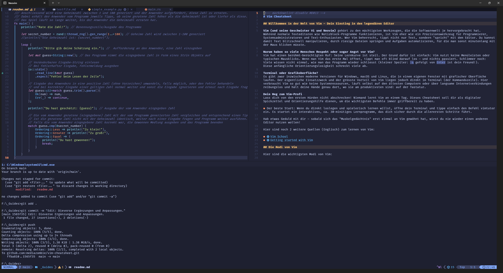

<!-- markdownlint-disable MD013 -->
# Vim Cheatsheet

## Willkommen in der Welt von Vim – Dein Einstieg in den legendären Editor

**Vim (und seine Geschwister Vi und Neovim)** gehört zu den mächtigsten Werkzeugen, die die Softwarewelt je hervorgebracht hat. Während normale Texteditoren wie Notizblock-Programme funktionieren, ist Vim eher ein Präzisionswerkzeug für Programmierer, Systemadministratoren und Text-Enthusiasten. Wer Vim beherrscht, tippt nicht nur Text, sondern «spricht» mit dem Editor. Damit lässt sich Text blitzschnell bearbeiten, man springt durch riesige Dateien und automatisiert Aufgaben, für die man sonst minutenlang mit der Maus klicken müsste.

### Warum haben so viele Menschen Respekt oder sogar Angst vor Vim?

Vim hat einen berühmt-berüchtigten Ruf: Die Lernkurve ist steil. Der Grund ist einfach: Vim nutzt keine Menüleisten und keine typischen Mausklicks. Wenn man Vim zum ersten Mal öffnet, tippt man oft blind drauflos – und nichts passiert. Schlimmer noch: Viele wissen nicht einmal, wie man das Programm wieder schliesst (kleiner Spoiler: `Esc`, dann `:q` gefolgt von `Enter` ist dein Freund!). Diese anfängliche Orientierungslosigkeit schreckt viele ab.

### Terminal oder Grafikoberfläche?

Es gibt inzwischen moderne Versionen für Windows, macOS und Linux, die in einem eigenen Fenster mit grafischer Oberfläche laufen. Der eigentliche Einsatzzweck und der grösste Vorteil von Vim liegen jedoch direkt im Terminal (der Kommandozeile). Hier verbraucht Vim so gut wie keine Systemressourcen, läuft selbst auf alten Computern oder über langsame Internetverbindungen reibungslos und hält deine Hände dort, wo sie am produktivsten sind: auf der Tastatur.

### Dein Weg zum Vim-Profi

Lass dich von den ersten Hürden nicht abschrecken! Niemand lernt Vim an einem Tag. Dieses Cheatsheet soll dir als digitaler Spickzettel und Orientierungshilfe dienen, damit du die wichtigsten Befehle immer griffbereit hast.

* **Der beste Start:** Wenn du direkt loslegen und spielerisch lernen willst, öffne dein Terminal und tippe den Befehl `vimtutor` ein. Er startet ein interaktives, ca. 30-minütiges Lernprogramm, das dich sicher durch die ersten Schritte führt.

Hab etwas Geduld mit dir selbst – sobald sich das «Muskelgedächtnis» an Vim gewöhnt hat, wirst du keinen anderen Editor mehr nutzen wollen!



Hier sind zwei weitere Quellen (Englisch) zum Lernen von Vim:

* [Vim School](https://vimschool.netlify.app/)
* [Getting started with Vim](https://opensource.com/article/19/3/getting-started-vim)

Hier ist noch ein weiteres Cheatsheet von "Josean Martinez" in Englisch (er hat auch sehr gute Videos zum Thema auf [YouTube](https://www.youtube.com/@joseanmartinez)):

* [Vim Essentials Cheatsheet & Guide](https://www.josean.com/posts/vim-essentials-cheatsheet)

### Schreibweise in diesem Cheatsheet

> [!NOTE]
> * `Ctrl-d` bedeutet: `Ctrl` gedrückt halten und gleichzeitig `d` drücken.
> * `Space f b` bedeutet: Die Tasten werden nacheinander gedrückt (nicht gleichzeitig).
> * `{Zeichen}` ist ein Platzhalter: Hier tippst du das gewünschte Zeichen. Die geschweiften Klammern gehören nicht zum Befehl.
> * Befehle, die mit `:` beginnen, werden in der Befehlszeile eingegeben und mit `Enter` bestätigt.

## Inhaltsverzeichnis

1. [Vim beenden und speichern](#vim-beenden-und-speichern)
2. [Die Modi von Vim](#die-modi-von-vim)
3. [Bewegen im Text](#bewegen-im-text)
4. [Text einfügen](#text-einfügen)
5. [Operatoren und Bewegungen](#operatoren-und-bewegungen)
6. [Löschen](#löschen)
7. [Ändern und Ersetzen](#ändern-und-ersetzen)
8. [Gross-/Kleinschreibung ändern](#gross-kleinschreibung-ändern)
9. [Kopieren, Einfügen und Register](#kopieren-einfügen-und-register)
10. [Wiederholen mit dem Punkt](#wiederholen-mit-dem-punkt)
11. [Rückgängig machen und Wiederherstellen](#rückgängig-machen-und-wiederherstellen)
12. [Visual-Modus in der Praxis](#visual-modus-in-der-praxis)
13. [Suchen](#suchen)
14. [Suchen und Ersetzen](#suchen-und-ersetzen)
15. [Sortieren](#sortieren)
16. [Arbeiten mit Zahlen](#arbeiten-mit-zahlen)
17. [Dateien, Buffer und Fenster](#dateien-buffer-und-fenster)
18. [Terminal in Vim](#terminal-in-vim)
19. [Neovim und LazyVim](#neovim-und-lazyvim)

## Vim beenden und speichern

Beenden ist ein Befehl der Befehlszeile. Drücke zuerst `Esc`, damit du sicher im `Normal`-Modus bist, tippe dann den Befehl ein und bestätige mit `Enter`.

| Eingabe | Funktion |
| :---: | :--- |
| `:q` | Vim beenden (nur wenn keine ungespeicherten Änderungen vorliegen) |
| `:q!` | Vim beenden und Änderungen verwerfen, ohne Nachfrage |
| `:w` | Datei speichern |
| `:wq` oder `:x` | Speichern und beenden |
| `ZZ` | Speichern und beenden (Normal-Modus, ohne `Enter`) |
| `ZQ` | Beenden ohne Speichern (Normal-Modus, ohne `Enter`) |

## Die Modi von Vim

Hier sind die wichtigsten Modi von Vim:

* **Normal-Modus** (Rückkehr mit `Esc`): Der Standardmodus für effiziente Navigation, Löschen und Textbearbeitung.
* **Insert-Modus** (Start z. B. mit `i`): Modus zum direkten Schreiben und Einfügen von neuem Text.
* **Visual-Modus** (Start mit `v`): Erlaubt das zeichenweise (`v`), zeilenweise (`Shift-v`) oder blockweise (`Ctrl-v`) Auswählen von Textpassagen.
* **Command-Line-Modus** (Start mit `:`): Eingabe von Befehlen wie z. B. Speichern (`:w`) oder Ersetzen (`:s`). Die Suche (`/`) wird ebenfalls in der Befehlszeile eingegeben.

> [!NOTE]
> Im Visual-Modus kann mit `o` zwischen dem Anfang und dem Ende der Markierung hin und her gesprungen werden. Das ist hilfreich, wenn man oberhalb oder unterhalb der Markierung noch etwas hinzufügen möchte.

## Bewegen im Text

### Grundbewegung

Um den Cursor zu bewegen, nutze die Tasten `h`, `j`, `k` und `l`.

| Eingabe | Funktion |
| :---: | :--- |
| `h` | Cursor nach links bewegen |
| `j` | Cursor nach unten bewegen |
| `k` | Cursor nach oben bewegen |
| `l` | Cursor nach rechts bewegen |

### Wortbewegung

| Eingabe | Funktion |
| :---: | :--- |
| `w` | Zum Anfang des nächsten Wortes springen |
| `e` | Zum Ende des aktuellen bzw. nächsten Wortes springen |
| `b` | Zum Anfang des aktuellen bzw. vorherigen Wortes zurückspringen |
| `ge` | Zum Ende des vorherigen Wortes zurückspringen |
| `W` | Wie `w`, aber Satzzeichen wie `,` gelten nicht als Wortgrenze (nur Leerzeichen) |
| `B` | Wie `b`, aber Satzzeichen wie `,` gelten nicht als Wortgrenze |

> [!NOTE]
> Mit einer vorangestellten Zahl werden mehrere Bewegungsschritte ausgeführt (z. B. springt `17b` um 17 Wörter zurück).

### Zeilenbewegung

| Eingabe | Funktion |
| :---: | :--- |
| `0` | An den Anfang der Zeile springen (Spalte 1) |
| `^` | Zum ersten Nicht-Leerzeichen der Zeile springen |
| `$` | An das Ende der Zeile springen |
| `f{Zeichen}` | In der aktuellen Zeile zum nächsten `{Zeichen}` springen (z. B. `f,`) |
| `;` | Letzte `f`-Suche zum nächsten Vorkommen wiederholen |
| `,` | Letzte `f`-Suche zum vorherigen Vorkommen wiederholen |

### Dokumentbewegung

| Eingabe | Funktion |
| :---: | :--- |
| `gg` | An den Anfang des Dokuments springen |
| `G` | An das Ende des Dokuments springen |
| `25G` oder `25gg` | Auf Zeile 25 springen |
| `:25` | Alternative: Auf Zeile 25 springen (Befehlszeile) |
| `H` | Zur ersten sichtbaren Zeile des Fensters springen |
| `M` | Zur mittleren sichtbaren Zeile des Fensters springen |
| `L` | Zur letzten sichtbaren Zeile des Fensters springen |

### Scrollen

| Eingabe | Funktion |
| :---: | :--- |
| `Ctrl-e` | Ansicht um eine Zeile nach unten scrollen, ohne den Cursor zu bewegen |
| `Ctrl-y` | Ansicht um eine Zeile nach oben scrollen, ohne den Cursor zu bewegen |
| `Ctrl-f` | Eine Seite vorwärts scrollen (wie `Page Down`) |
| `Ctrl-b` | Eine Seite rückwärts scrollen (wie `Page Up`) |
| `Ctrl-d` | Eine halbe Seite nach unten scrollen (`d` für Down) |
| `Ctrl-u` | Eine halbe Seite nach oben scrollen (`u` für Up) |
| `zz` | Aktuelle Zeile im Fenster zentrieren |
| `zt` | Aktuelle Zeile am oberen Fensterrand ausrichten |
| `zb` | Aktuelle Zeile am unteren Fensterrand ausrichten |

### Satz- und Absatzbewegung

| Eingabe | Funktion |
| :---: | :--- |
| `(` | Zum Anfang des aktuellen bzw. vorherigen Satzes springen |
| `)` | Zum Anfang des nächsten Satzes springen |
| `{` | Zum vorherigen Absatz springen (Absätze sind durch Leerzeilen getrennt) |
| `}` | Zum nächsten Absatz springen |

> [!NOTE]
> Mit `{` und `}` kann man sich blockweise durch Text bzw. Code bewegen.

### Passende Klammern finden

Mit `%` springt der Cursor von einer Klammer `(`, `[` oder `{` zur passenden Gegenklammer. Das funktioniert in beide Richtungen, je nachdem, ob der Cursor auf der öffnenden oder der schliessenden Klammer steht.

> [!NOTE]
> Diese Funktion ist vor allem beim Bearbeiten von Programmcode hilfreich, um fehlende Klammern zu finden.

### Sprungliste

Vim speichert grössere Positionswechsel (z. B. `42G`, `gg`, `G`, Suchen), nicht jedoch «normale» Bewegungen wie `j`, `k` oder `Ctrl-u`/`Ctrl-d`.

| Eingabe | Funktion |
| :---: | :--- |
| `Ctrl-o` | Zur vorherigen Position der Sprungliste zurückspringen |
| `Ctrl-i` | In der Sprungliste wieder vorwärts springen |
| `Ctrl-g` | Datei- und Zeileninfo unten im Fenster anzeigen |

> [!TIP]
> `Ctrl-o` und `Ctrl-i` sind vergleichbar mit dem Zurück- und Vorwärts-Button eines Webbrowsers. Das funktioniert nach einer Suche ebenso wie nach `gg` oder `G`.
> Mit `Ctrl-g` siehst du die aktuelle Zeilennummer. Merkst du sie dir, kannst du dich durch das Dokument bewegen und später mit `{Zeilennummer}G` wieder zurückkehren.

### Marker

| Eingabe | Funktion |
| :---: | :--- |
| `ma` | Marker setzen – `a` ist variabel und kann durch jeden Buchstaben ersetzt werden |
| `'a` | Zum Anfang der Zeile des gespeicherten Markers `a` springen |
| `` `a `` | Exakt zu Zeile und Spalte des gespeicherten Markers `a` springen |

Es gibt lokale und globale Marker:

| Typ | Buchstabe | Reichweite und Verhalten |
| :--- | :---: | :--- |
| Lokale Marker | `a` bis `z` | Gelten nur innerhalb der aktuellen Datei. `ma` in Datei X und `ma` in Datei Y sind voneinander unabhängig. |
| Globale Marker | `A` bis `Z` | Gelten dateiübergreifend. Setzt du in Datei X `mA`, bearbeitest später Datei Y und drückst `'A`, öffnet Vim automatisch wieder Datei X und springt zur Position. |

#### Integrierte Marker

Vim setzt viele nützliche Marker automatisch, ohne dass man sie zuerst speichern muss.

* `''` (zwei Apostrophe): Springt zur Position vor dem letzten Sprung (praktisch nach `G` oder `gg`).
* `'.`: Springt zur Zeile der letzten Änderung.
* `'^`: Springt zur Position, an der der Insert-Modus zuletzt verlassen wurde.
* `'[` und `']`: Springen zum Anfang bzw. Ende des zuletzt veränderten oder eingefügten Textes.

#### Übersicht behalten

Wenn du vergessen hast, welche Marker du gesetzt hast, hilft der Befehl `:marks` weiter.

## Text einfügen

Um Text in Vim zu schreiben, muss in den `Insert`-Modus gewechselt werden. Die gebräuchlichste Möglichkeit dazu ist die Taste `i`. Zurück in den Normal-Modus geht es mit `Esc`.

| Eingabe | Funktion |
| :---: | :--- |
| `i` | Text vor der Cursor-Position einfügen |
| `a` | Text hinter der Cursor-Position einfügen |
| `Shift-i` (`I`) | Zum ersten Nicht-Leerzeichen der Zeile springen und dort den Insert-Modus starten |
| `Shift-a` (`A`) | Hinter das letzte Zeichen der Zeile springen und dort den Insert-Modus starten (Anhängen) |
| `o` | Neue Zeile unterhalb der aktuellen einfügen und den Insert-Modus starten |
| `Shift-o` (`O`) | Neue Zeile oberhalb der aktuellen einfügen und den Insert-Modus starten |

## Operatoren und Bewegungen

Vim funktioniert nach dem Prinzip **Operator + Bewegung**. Ein Operator (z. B. `d` für Löschen, `c` für Ändern, `y` für Kopieren) wird mit einer Bewegung kombiniert und wirkt auf den Bereich, den die Bewegung überstreicht.

Beispiel mit dem Löschoperator `d`:

| Eingabe | Funktion |
| :---: | :--- |
| `dw` | Von der Cursor-Position bis zum Beginn des nächsten Wortes löschen (inkl. Leerzeichen) |
| `de` | Von der Cursor-Position bis zum Ende des aktuellen Wortes löschen (inkl. letztem Zeichen) |
| `d$` | Von der Cursor-Position bis zum Ende der Zeile löschen (inkl. letztem Zeichen) |

### Verwendung eines Zählers mit einer Bewegung

Gibt man vor einer Bewegung eine Zahl ein, wird die Bewegung entsprechend oft wiederholt. Bei `12w` bewegt sich der Cursor z. B. um 12 Wörter vorwärts. Das funktioniert auch mit den Richtungstasten `h`, `j`, `k`, `l`: Um 128 Zeilen nach unten zu springen, gibt man `128j` ein.

### Verwendung eines Zählers mit einem Operator

Operator und Zähler lassen sich kombinieren. Mit `d2w` werden die nächsten zwei Wörter gelöscht, mit `dw` nur eines. Analog löscht `dd` die aktuelle Zeile und `5dd` die nächsten fünf Zeilen (inkl. der aktuellen).

### Text-Objekte

Text-Objekte beschreiben Bereiche rund um den Cursor. Mit `i` (inner) wird der Inhalt ohne Begrenzer gewählt, mit `a` (around) inklusive Begrenzer. Sie lassen sich mit jedem Operator kombinieren.

| Eingabe | Funktion |
| :---: | :--- |
| `iw` / `aw` | Wort (ohne / mit nachfolgendem Leerzeichen) |
| `is` / `as` | Satz (ohne / mit nachfolgendem Leerzeichen) |
| `ip` / `ap` | Absatz (ohne / mit angrenzender Leerzeile) |
| `i"` / `a"` | Text zwischen Anführungszeichen (ohne / mit den Zeichen) |
| `ib` oder `i(` | Inhalt der runden Klammern `()` |
| `iB` oder `i{` | Inhalt der geschweiften Klammern `{}` |
| `i[` / `a[` | Inhalt der eckigen Klammern `[]` (ohne / mit den Klammern) |

Beispiele:

* `diw` löscht das Wort unter dem Cursor.
* `dis` löscht den aktuellen Satz, `das` den Satz inklusive nachfolgendem Leerzeichen.
* `vip` markiert den aktuellen Absatz im Visual-Modus, `yap` kopiert ihn.
* `vi"` markiert den Text zwischen Anführungszeichen, `ya"` kopiert ihn inklusive der Anführungszeichen.
* `vab` markiert einen Block inklusive der runden Klammern, `vaB` inklusive der geschweiften Klammern.

> [!NOTE]
> Der Cursor muss für `vib`/`viB` innerhalb des jeweiligen Klammerpaares stehen. Bei Anführungszeichen genügt es, wenn sie in der aktuellen Zeile vorkommen.

## Löschen

Zur Sicherheit zuvor jeweils die Taste `Esc` drücken, damit du dich im `Normal`-Modus befindest.

| Eingabe | Funktion |
| :---: | :--- |
| `x` | Zeichen unter dem Cursor löschen |
| `dw` | Von der Cursor-Position bis zum Beginn des nächsten Wortes löschen (inkl. Leerzeichen) |
| `de` | Von der Cursor-Position bis zum Ende des aktuellen Wortes löschen |
| `diw` | Wort löschen – der Cursor kann irgendwo im Wort stehen |
| `d$` oder `D` | Von der Cursor-Position bis zum Ende der Zeile löschen |
| `dd` | Ganze Zeile löschen |
| `2dd` | Die aktuelle und die darunterliegende Zeile löschen (allgemein: `Ndd` löscht N Zeilen) |
| `dG` | Von der aktuellen Zeile bis zum Dateiende löschen (zeilenweise) |

## Ändern und Ersetzen

Mit dem Change-Operator `c` in Kombination mit einer Bewegung werden Zeichen gelöscht und der Insert-Modus wird sofort gestartet.

| Eingabe | Funktion |
| :---: | :--- |
| `r` | Zeichen unter dem Cursor durch das nächste getippte Zeichen ersetzen (bleibt im Normal-Modus) |
| `cw` oder `ce` | Von der Cursor-Position bis zum Ende des aktuellen Wortes ändern |
| `c$` oder `C` | Von der Cursor-Position bis zum Ende der Zeile ändern |
| `cc` | Ganze Zeile ändern |
| `ciw` | Das ganze Wort ändern, egal wo der Cursor im Wort steht (**C**hange **I**nner **W**ord) |

## Gross-/Kleinschreibung ändern

| Eingabe | Funktion |
| :---: | :--- |
| `~` | Gross-/Kleinschreibung des Zeichens unter dem Cursor umschalten und den Cursor nach rechts bewegen |
| `4g~w` | Gross-/Kleinschreibung der nächsten 4 Wörter umschalten |
| `4guw` | Die nächsten 4 Wörter in Kleinbuchstaben umwandeln (aus `HALLO` wird `hallo`) |
| `4gUw` | Die nächsten 4 Wörter in Grossbuchstaben umwandeln (aus `hallo` wird `HALLO`) |

> [!NOTE]
> Bei der CH- bzw. DE-Tastaturbelegung ist `~` eine Tottaste. Daher muss nach dem Tippen von `~` zusätzlich ein `Leerzeichen` eingegeben werden.

> [!TIP]
> Viele Befehle lassen sich auch mit dem Visual-Modus umsetzen. So ändert `v4w` gefolgt von `gU` die nächsten 4 Wörter ebenfalls in Grossbuchstaben.

## Kopieren, Einfügen und Register

Das Kopieren heisst in Vim «yank» (`y`), das Einfügen «put» (`p`). Wie beim Löschen wird `y` mit einer Bewegung oder einem Text-Objekt kombiniert.

| Eingabe | Funktion |
| :---: | :--- |
| `yy` | Aktuelle Zeile kopieren |
| `yw` | Von der Cursor-Position bis zum Beginn des nächsten Wortes kopieren |
| `yiw` | Das Wort unter dem Cursor kopieren |
| `yi"` / `ya"` | Text zwischen Anführungszeichen kopieren (ohne / mit den Zeichen) |
| `p` | Zwischengespeicherten Inhalt nach dem Cursor einfügen (bei ganzen Zeilen: unterhalb der aktuellen Zeile) |
| `P` | Zwischengespeicherten Inhalt vor dem Cursor einfügen (bei ganzen Zeilen: oberhalb der aktuellen Zeile) |

### Register

Vim besitzt einen sehr mächtigen Zwischenspeicher, die sogenannten Register. Mit dem Befehl `:reg` (Enter nicht vergessen) werden alle Register mit den aktuell gespeicherten Werten angezeigt. Das Fenster lässt sich mit `q` wieder schliessen.

| Eingabe | Funktion |
| :---: | :--- |
| `"3p` | Inhalt aus Register 3 einfügen |
| `"ayy` | Aktuelle Zeile in Register `a` kopieren |
| `"ap` | Inhalt aus Register `a` einfügen |
| `"+y` | In die Zwischenablage des Betriebssystems kopieren |
| `"+p` | Aus der Zwischenablage des Betriebssystems einfügen |
| `Ctrl-r "` | (Insert-Modus) Inhalt des unbenannten Registers einfügen |

> [!NOTE]
> Mit `"` wird der Zugriff auf ein bestimmtes Register eingeleitet (gefolgt von einer Nummer oder einem Zeichen), danach folgt der eigentliche Befehl (z. B. `p`).
> Die speziellen Register `+` und `*` greifen je nach Betriebssystem auf die Zwischenablage des Betriebssystems zu. So lassen sich in Vim kopierte Inhalte in anderen Programmen einfügen (und umgekehrt).

### Beispiel: Ein Wort fett formatieren

Ein Wort in einem Markdown-Text soll **fett** werden. Positioniere den Cursor irgendwo im Wort und gib im Normal-Modus folgende Tastenfolge ein:

```text
viwc**<Ctrl-r>"**<Esc>
```

**Was ist passiert?**

1. `viw` markiert das ganze Wort.
2. `c` schneidet das Wort aus und wechselt in den Insert-Modus.
3. `**` gibt die öffnenden Markdown-Formatierungszeichen für **Fett** ein.
4. `Ctrl-r "` fügt das ausgeschnittene Wort aus dem unbenannten Register `"` wieder ein.
5. `**` gibt die schliessenden Formatierungszeichen ein.
6. `Esc` wechselt zurück in den Normal-Modus.
7. Um die Formatierung auf weitere Wörter anzuwenden, mit `w` zum nächsten Wort springen und `.` tippen (lässt sich beliebig oft wiederholen).

## Wiederholen mit dem Punkt

Mit `.` wird die letzte Änderung wiederholt. Wurde zuvor z. B. `diw` ausgeführt, springt man mit `w` zum nächsten Wort und wiederholt dort mit `.` den Befehl `diw`, ohne ihn erneut einzugeben. Das funktioniert mit den meisten Änderungsbefehlen – einfach ausprobieren.

> [!TIP]
> Auch die Wiederholung lässt sich mit einem Zähler kombinieren, z. B. wiederholt `3.` die letzte Änderung dreimal.

## Rückgängig machen und Wiederherstellen

Auch in Vim lassen sich Änderungen rückgängig machen, allerdings **nicht** mit `Ctrl-z`. Im Terminal schickt `Ctrl-z` Vim in den Hintergrund (Rückkehr mit `fg`).

| Eingabe | Funktion |
| :---: | :--- |
| `u` | Letzte Änderung rückgängig machen (wiederholbar, Schritt für Schritt) |
| `Ctrl-r` | Rückgängig gemachte Änderung wiederherstellen (Redo, im Normal-Modus) |
| `U` | Alle Änderungen in der zuletzt bearbeiteten Zeile rückgängig machen (ein weiteres `U` macht dies rückgängig) |

## Visual-Modus in der Praxis

Im Visual-Modus wird zuerst ausgewählt und danach ein Operator angewendet. Das ist besonders für Einsteiger intuitiv.

| Eingabe | Funktion |
| :---: | :--- |
| `v` | Zeichenweise auswählen |
| `Shift-v` (`V`) | Zeilenweise auswählen |
| `Ctrl-v` | Blockweise (spaltenweise) auswählen |
| `o` | Zwischen Anfang und Ende der Auswahl wechseln |
| `gv` | Letzte Auswahl erneut markieren |
| `d`, `c`, `y`, `gU` | Operator auf die Auswahl anwenden (löschen, ändern, kopieren, in Grossbuchstaben umwandeln) |

> [!TIP]
> Ein Beispiel für die Kombination mit Text-Objekten: `vi"` markiert den Text zwischen Anführungszeichen, danach ändert `c` den markierten Text.

## Suchen

Drücke `Esc`, um sicher im `Normal`-Modus zu sein. Tippe dann `/` direkt gefolgt vom Suchbegriff, zum Beispiel `/Woort` (bestätigen mit `Enter`). Das ist das Wort oder (in diesem Fall) der Tippfehler, nach dem du suchen willst.

| Eingabe | Funktion |
| :---: | :--- |
| `/Begriff` | Vorwärts nach `Begriff` suchen |
| `?Begriff` | Rückwärts nach `Begriff` suchen |
| `n` | Zum nächsten Treffer springen (**N**ext) |
| `N` | Zum vorherigen Treffer springen (Gegenrichtung) |
| `*` | Das Wort unter dem Cursor vorwärts suchen (ganzes Wort), danach mit `n` bzw. `N` weitersuchen |
| `#` | Das Wort unter dem Cursor rückwärts suchen (ganzes Wort) |

> [!TIP]
> Bist du mittels Suche an der gewünschten Stelle angekommen und möchtest danach wieder zur vorherigen Position zurück, drücke `Ctrl-o` (vorwärts: `Ctrl-i`).

## Suchen und Ersetzen

`:s/alt/neu/` ersetzt auf der aktuellen Zeile das erste Vorkommen von `alt` durch `neu`. Mit Flags lässt sich das Verhalten steuern:

* `g` (global): Alle Treffer in der Zeile ersetzen, nicht nur den ersten.
* `c` (confirm): Bei jedem Treffer nachfragen.

Der Bereich vor dem `s` bestimmt, wo ersetzt wird: `%` steht für das ganze Dokument, `5,12` für die Zeilen 5 bis 12.

| Eingabe | Funktion |
| :---: | :--- |
| `:s/alt/neu/g` | Auf der aktuellen Zeile alle Treffer von `alt` durch `neu` ersetzen |
| `:%s/alt/neu/g` | Im ganzen Dokument alle Treffer ersetzen (z. B. Variablennamen) |
| `:%s/alt/neu/gc` | Im ganzen Dokument ersetzen, bei jedem Treffer nachfragen |
| `:5,12s/alt/neu/g` | Nur in den Zeilen 5 bis 12 ersetzen |
| `:5,12s/alt/neu/gc` | Nur in den Zeilen 5 bis 12 ersetzen, bei jedem Treffer nachfragen |
| `:'<,'>s/alt/neu/g` | Nur im markierten (Visual-)Bereich ersetzen |

> [!NOTE]
> Drückt man im Visual-Modus `:`, erscheint automatisch `'<,'>` in der Befehlszeile. Das ist der markierte Bereich.

## Sortieren

Auch die alphabetische Sortierung beherrscht Vim bzw. Neovim!  
Möchte man beispielsweise die folgende Liste sortieren, setzt man den Cursor in die Liste, markiert sie mit `vip` (oder zeilenweise mit `Shift-v`) und gibt `:sort` ein (bestätigen mit `Enter`).

Beispielliste zum Testen:

```text
apples
bananas
watermelons
oranges
grapes
cigarettes
kiwis
raspberries
```

| Eingabe | Funktion |
| :---: | :--- |
| `:sort` | Alphabetisch sortieren |
| `:sort i` | Gross-/Kleinschreibung ignorieren (standardmässig kommen Grossbuchstaben zuerst) |
| `:sort u` | Duplikate entfernen (sortiert die Liste und löscht doppelte Einträge) |
| `:sort n` | Numerisch sortieren (sinnvoll, wenn Zeilen mit Zahlen beginnen) |

> [!TIP]
> So bringst du die Beispielliste sortiert und durch Kommas getrennt in eine Zeile:
>
> 1. `vip` markiert die ganze Liste.
> 2. `:sort` und `Enter` sortieren die Auswahl.
> 3. `gv` markiert die Auswahl erneut.
> 4. `:s/\n/, /` und `Enter` ersetzen die Zeilenumbrüche durch `, `.
>
> Einfacher, aber ohne Komma, geht es mit `J`: Liste mit `vip` markieren, mit `:sort` sortieren, mit `gv` erneut markieren und mit `J` in eine Zeile zusammenführen (getrennt durch ein Leerzeichen).

## Arbeiten mit Zahlen

Auch mit Zahlen kann Vim bzw. Neovim Erstaunliches anstellen.

| Eingabe | Funktion |
| :---: | :--- |
| `Ctrl-a` | Zahl unter bzw. nach dem Cursor um 1 erhöhen |
| `Ctrl-x` | Zahl unter bzw. nach dem Cursor um 1 verringern |
| `g` + `Ctrl-a` | (Visual-Modus) Zahlen der Auswahl fortlaufend hochzählen |

Angenommen, du möchtest die folgenden Zahlen der Reihe nach durchnummerieren. Markiere alle Zeilen ausser der ersten Null (diese soll so bleiben) mit dem Visual-Block-Modus (`Ctrl-v`) oder dem Visual-Line-Modus (`Shift-v`). Drücke danach `g` und anschliessend `Ctrl-a`. Die Zahlen werden automatisch fortlaufend durchnummeriert.

```text
0
0
0
0
0
0
0
0
0
0
0
```

> [!TIP]
> Um sofort eine Liste aufeinanderfolgender Zahlen zu erzeugen, gib `:put =range(0,6)` ein. Du erhältst eine vertikale Liste mit den Zahlen `0` bis `6`. Um diese hintereinander, durch Leerzeichen getrennt, auszugeben, markiere sie mit `vip` und drücke `J`.

## Dateien, Buffer und Fenster

### Bearbeiten, Speichern und Schliessen

| Eingabe | Funktion |
| :---: | :--- |
| `:e pfad/datei` | Eine Datei (aus dem aktuellen oder einem anderen Verzeichnis) zum Bearbeiten öffnen, wenn Vim bereits läuft |
| `:w` | Aktuelle Datei (aktiven Buffer) speichern |
| `:q` | Aktives Fenster schliessen. Bei ungespeicherten Änderungen wird eine Meldung ausgegeben und das Fenster bleibt offen |
| `:bd` | Aktuellen Buffer schliessen (die Datei ist anschliessend nicht mehr im Speicher) |
| `:bd N` | Buffer mit der Nummer `N` schliessen |

### Buffer

> [!NOTE]
> Mit Buffer sind geöffnete Dateien in der aktuellen Vim-Sitzung gemeint. Man kann in Vim mehrere Dateien gleichzeitig geöffnet haben und mit den entsprechenden Befehlen zwischen ihnen wechseln, auch wenn sie nicht direkt sichtbar sind.

| Eingabe | Funktion |
| :---: | :--- |
| `:ls` | Alle geöffneten Buffer auflisten |
| `:bnext` / `:bprev` | Zum nächsten bzw. vorherigen Buffer wechseln |
| `:b#` | Zum zuletzt genutzten Buffer wechseln |

### Fenster teilen und wechseln

Vim kann auch geteilte Fenster!

| Eingabe | Funktion |
| :---: | :--- |
| `:split Datei` | Datei in einem horizontal geteilten Fenster öffnen (oberes/unteres Fenster) |
| `:vsplit Datei` | Datei in einem vertikal geteilten Fenster öffnen (linkes/rechtes Fenster) |
| `Ctrl-w h/j/k/l` | Zwischen den Fenstern wechseln (links/unten/oben/rechts) |

## Terminal in Vim

| Eingabe | Funktion |
| :---: | :--- |
| `:term` | Terminal im aktuellen Fenster öffnen |
| `:split \| term` | Terminal in einem horizontal geteilten Fenster öffnen |
| `:vsplit \| term` | Terminal in einem vertikal geteilten Fenster öffnen |

## Neovim und LazyVim

> [!NOTE]
> Neovim ist historisch gesehen eine moderne Weiterentwicklung von Vi bzw. Vim.
> LazyVim hingegen ist eine sehr mächtige Konfiguration für Neovim, die es quasi zu einer vollwertigen IDE (Entwicklungsumgebung) macht.
> Die folgenden Tastenkombinationen funktionieren nur mit Neovim und LazyVim.

| Eingabe | Funktion |
| :---: | :--- |
| `Ctrl-h` / `Ctrl-j` / `Ctrl-k` / `Ctrl-l` | Zwischen Fenstern wechseln (alternativ `Ctrl-w h/j/k/l`) |
| `Shift-h` | Vorheriger Buffer |
| `Shift-l` | Nächster Buffer |
| `Space f b` | Durchsuchbare Liste aller offenen Buffer anzeigen |
| `Space f t` | Terminal im aktuellen Verzeichnis öffnen |
| `Space f T` | Terminal im Root-Verzeichnis des Projekts öffnen |
| `Space u s` | Rechtschreibprüfung ein-/ausschalten |
